# AI DataOps Agent with VSL Governance

An AI-assisted DataOps incident workflow. An agent **investigates data-pipeline incidents using read-only tool evidence**,
a person **reviews and approves** any proposed fix, a **VSL governance layer gates** the protected action, a tightly
allow-listed **simulated recovery** runs, and every governance decision is written to **VerbaLedger**, a hash-chained
JSON Lines ledger.

> **Everything here runs against a simulation.** The data is synthetic, the services are local, and recovery acts only on
> a simulated environment. Nothing in this repository touches a real company system, and no real production recovery is
> performed. Authentication is a development-only static-token scheme.

**What is different about it.** The LLM can read but cannot act. A fix is only ever a *proposal*; it is turned into an
action only after (1) a verified report, (2) cited known evidence, and (3) a human approval bound to that exact action are
all present, and those checks are enforced in code by VSL constructs (`PreNode`, `Invariant`, `TerminalState`) rather than
by the prompt. Investigation, recommendation, authorisation, execution and recording are separate steps with separate code
paths (see [VSL governance](#vsl-governance)). This is a reference design and learning project, not a certified or
production-ready product (see [Project status](#project-status)).

## Table of contents

1. [Overview and scope](#overview-and-scope)
2. [End-to-end workflow](#end-to-end-workflow) (10 stages)
3. [VSL governance](#vsl-governance)
4. [Architecture and tech stack](#architecture-and-tech-stack)
5. [Repository structure](#repository-structure)
6. [API reference](#api-reference)
7. [Installation and setup](#installation-and-setup)
8. [Running the application](#running-the-application)
9. [Screenshots](#screenshots)
10. [Testing and validation](#testing-and-validation)
11. [Security and safeguards](#security-and-safeguards)
12. [Troubleshooting](#troubleshooting)
13. [Project status](#project-status)
14. [Future development](#future-development)
15. [Documentation validation notes](#documentation-validation-notes)

---

## Overview and scope

| Question | Answer |
|---|---|
| What problem does it explore? | Working out *why* a pipeline failed and fixing it safely, with an AI agent whose power is bounded and whose decisions are auditable. |
| What can the agent do? | Call 11 read-only diagnostic tools through an MCP server (stdio) and write a structured report. It cannot write anywhere. |
| What can change state? | Only the recovery runner (`app/recovery/runner.py`), after approval and VSL gates, on a simulated environment, and only for two allow-listed actions. |
| Which model does it use? | By default **none**: an offline deterministic heuristic planner/reporter. Live OpenAI (`INVESTIGATION_MODE=live`) is implemented but **not validated** by the author. |
| Who is it for? | Engineers evaluating governed AI-agent patterns: LangGraph orchestration, MCP tooling, human-in-the-loop approval, audit trails. |

**Not in scope / not used:** no vector database, RAG, LangChain, Kubernetes or cloud deployment is implemented. A `Dockerfile`,
`docker-compose.yml` and a GitHub Actions workflow exist as foundations but were not executed by the author (see
[Documentation validation notes](#documentation-validation-notes)).

---

## End-to-end workflow

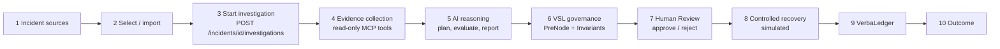

The stages below describe what the code does. Where something depends on configuration, that is stated.

### Stage 1: Incident sources

Four data sets exist; the dashboard never adds them together:

| Source | Where it lives | Notes |
|---|---|---|
| SQL Server simulator `dataops_sim` | SQL Server via `pyodbc` (`app/simulation/`) | Pipelines, runs, validation results and simulator incidents (baseline `INC-0001`, `INC-0002`). Read-only in the API and dashboards. |
| Synthetic simulator incidents | Same database, rows added by `python -m scripts.db_seed_demo_incidents` (`app/simulation/demo_incidents.py`, 98 rows) | Explicit, additive, idempotent; nothing seeds automatically at startup. |
| Synthetic in-process demo set | `app/demo/incidents.py` (100 `DEMO-nnnn` records), served by `/api/v1/demo/*` | Isolated: not in any database, not investigable. A separate dataset from the row above. |
| Workflow store | SQLite `data/operations.sqlite3` (`app/persistence/`) | Holds *workflow* incidents, investigations, recoveries and ticket records. |

There is **no automatic synchronisation** from SQL Server to the workflow store. A simulator incident enters the workflow only
through an explicit, idempotent import (`POST /api/v1/simulator/incidents/{incident_id}/import`); a second import reports that it
already exists. Workflow incidents can also be created directly with `POST /api/v1/incidents`.

### Stage 2: Incident selection

In the Operations Dashboard (`dashboard/ops_app.py`) the **Incidents** page offers three sources: *Workflow incidents*,
*SQL Server simulator* and *Synthetic demo (100)*. A simulator incident is imported, then investigated from the same page.

**Limitation:** the synthetic demo set (100 `DEMO-nnnn`) is browse-only. It has no Import or Investigate action, so it cannot
be taken through the workflow. Only workflow incidents (created or imported) can be investigated.

### Stage 3: Starting the investigation

`POST /api/v1/incidents/{incident_id}/investigations` (`app/api/v1/routes/incidents.py`), requires `investigation:run`
(roles `investigator`, `operator`).

1. The route calls `InvestigationService.start` (`app/services/investigations.py`), which stores a *pending* investigation
   and returns **HTTP 202** with its id.
2. `InvestigationService.execute` runs as a FastAPI `BackgroundTasks` job and calls `app.agent.investigate(...)`.
3. The result (or a classified error: `invalid_incident`, `live_mode_unavailable`, `model_error`, `mcp_unavailable`,
   `agent_failure`, `not_found`) is saved to the operations store.
4. Clients poll `GET /api/v1/investigations/{investigation_id}` or `GET /api/v1/incidents/{incident_id}/report`.
   The dashboard waits up to 10 seconds, then shows "still running" until refreshed.

Starting an investigation never marks the incident resolved.

### Stage 4: Evidence collection

The agent is a LangGraph state machine in `app/agent/graph.py`:

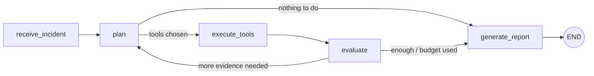

* Tools are reached over **stdio MCP** (`app/agent/mcp_client.py` to `app/mcp_server/server.py`). The agent only accepts
  tools in `APPROVED_TOOLS` and checks that each is annotated read-only.
* The MCP server exposes **11 read-only tools** backed by `app/diagnostics/readonly.py`. `ReadOnlyRepo` has a `READ_METHODS`
  allow-list, so the guarantee is application-level (it is not a database-level read-only account).
* Every tool call is recorded with an evidence id. The report separates:
  * **observed facts**: what a tool returned (cited by evidence id),
  * **interpretation**: the model's reading of those facts,
  * **hypotheses**: likely causes, always labelled *not confirmed*,
  * **unavailable information / limitations**: what could not be checked.
* Budgets (defaults in `app/agent/config.py`): 3 planning rounds, 12 tool calls in total, 4 per round. `evaluate` is pure code and stops on budget, no new evidence or repeated invalid calls.

### Stage 5: AI reasoning

| Aspect | Behaviour |
|---|---|
| Default mode | **Offline.** `app/agent/offline.py` is a deterministic heuristic planner and reporter. No network call is made. |
| Live mode | `INVESTIGATION_MODE=live` with `OPENAI_API_KEY` uses `OpenAIChatModel` (`app/agent/llm.py`) with JSON-schema structured output. The default model name is `gpt-4o-mini` (`AgentConfig.model` in `app/agent/config.py`, configurable). **Not validated by the author**: it may bill your account and the quality of its output is unmeasured. |
| Prompts | `PLAN_SYSTEM` and `REPORT_SYSTEM` in `app/agent/prompts.py`. |
| Validation | `finalize_report` (`app/agent/report.py`) checks the report **in code**: findings must cite evidence ids that really came from tool calls; unsupported claims are not accepted as confirmed. |

The model never receives write tools, and its output is never executed directly.

### Stage 6: VSL governance

Detailed in [VSL governance](#vsl-governance). In short: an investigation report can be turned into a *proposal*; the gates
check it; only a gated, approved action reaches the recovery runner.

### Stage 7: Human Review and approval

* A recovery proposal is created from a stored investigation report with `POST /api/v1/incidents/{incident_id}/recoveries`
  (role `operator`). The action is derived from evidence, not typed by a person.
* `GET /api/v1/reviews`, `/reviews/summary` and `/reviews/{review_id}` list only items genuinely waiting for a person.
* `POST /api/v1/approvals/{request_id}/decision` records approve or reject. The route needs `approval:decide`
  (`recovery_approver`, `recovery_admin`), and the approval service separately requires the per-action permission
  `recovery:approve:<action>` (`app/recovery/auth.py`).
* The approval service (`app/recovery/approvals.py`) binds an approval to the **exact action** by digest, seals it with an
  HMAC, makes it **single-use** (atomic consumption) and expires it (default **30 minutes**, maximum 24 hours). A decision
  cannot silently overwrite an earlier one.

Illustrative example (not captured output): an investigation of a duplicate-orders incident cites two tool results showing
repeated order ids and proposes `remove_injected_condition` for scenario `duplicate-records`. A reviewer with the approver
role sees the evidence, hypothesis, action and risk (`high`), and approves with a reason. For the verified behaviour
see the tests listed under [Testing and validation](#testing-and-validation).

### Stage 8: Controlled recovery (simulated)

* `POST /api/v1/recoveries/{recovery_id}/resume` continues a recovery after approval.
* The recovery workflow (`app/recovery/workflow.py`) is a LangGraph graph with `interrupt_before` and an in-memory
  checkpointer, wrapping the governed workflow.
* `RecoveryRunner` (`app/recovery/runner.py`) is the **only** code that causes a side effect. Only two actions exist
  (`app/recovery/actions.py`): `rerun_pipeline` (medium risk, one of three simulated pipelines) and
  `remove_injected_condition` (high risk, one of six simulation scenarios). Parameter schemas reject unknown fields.
  There is no shell, free SQL or dynamic code.
* A precondition is checked before execution and an **independent postcondition re-read** verifies the result afterwards.
* **Simulated only.** Recovery changes rows in the simulation database, never a real system. It refuses any database that is
  not in-memory or whose name does not end in `_test`. For that reason, with `DB_NAME=dataops_sim` Human Review and recovery
  are intentionally **unavailable** (HTTP 503, code `recovery_unavailable`); see
  [Enable Human Review and recovery](#enable-human-review-and-recovery).

### Stage 9: VerbaLedger and audit

* Governance events are appended to `data/governance_ledger.jsonl` by `app/governance/ledger.py` using the VerbaLedger library
  (hash-chained entries).
* The read-only API (`/api/v1/ledger/*`, role permission `ledger:read`) and the **VerbaLedger Explorer** (`dashboard/ledger_app.py`)
  expose summary counts, an event table and detail, a causal trace, an integrity check and a semantic audit
  (`app/governance/ledger_view.py`).
* **What the integrity check does and does not show.** It re-walks the hash chain and reports inconsistencies within the file.
  It cannot detect deletion of the file's tail or replacement by an older, internally consistent chain unless you hold an
  external checkpoint (the API returns one). This is *tamper-evidence within one file*, not tamper-proofing, immutability,
  or any compliance certification.
* A fresh install has an empty ledger; events appear only after the governed workflow runs. Nothing is pre-filled.

### Stage 10: Results and outcome

An incident passes through different states that are **not interchangeable**:

| State | Meaning |
|---|---|
| Investigated | A report exists. Nothing was changed. |
| Awaiting review | A recovery proposal is waiting for a human. |
| Approved / rejected | A decision is recorded; approval is single-use. |
| Executed and verified | The runner executed the action **and** the independent postcondition check passed. |
| Executed, not verified / failed / refused | Shown as such; never reported as success. |

`GET /api/v1/incidents/{incident_id}/status` returns a derived workflow status, and the Human Review page keeps the outcome
visible after the item leaves the queue. Every outcome corresponds to ledger events that you can inspect.

---

## VSL governance

VSL (the `vsl_core` library, with the `vsl_langgraph` adapter pinned in `requirements.txt`) supplies the governance
constructs. This repository wires them around the protected action.

| Concern | Implemented by |
|---|---|
| Policy constructs | `app/governance/policy.py`: `build_policy`, `Policy`, `PreNode` named `verified_report_and_approval`, invariants `action_within_allowlist` and `no_execution_while_suspended`, `TerminalState` named `automation_suspended` |
| Gate compilation | `app/governance/gates.py`: `compile_gates`, `validate_policy`, `candidate_of`, compiled through `vsl_langgraph.LangGraphAdapter` |
| Orchestration | `app/governance/workflow.py`: `GovernedActionService`, a LangGraph graph that loads context, checks suspension, checks the allow-list, evaluates the PreNode, authorises and runs the protected action |
| Proposal input | `proposal_from_report`: only the report status and cited evidence ids are used. Model confidence is never an input |
| Recording | `app/governance/ledger.py`: `GovernanceRecorder`, `open_ledger` (VerbaLedger, JSONL) |
| Audit | `app/governance/ledger_view.py` and `audit_cli.py` |

**PreNode preconditions** (`failed_preconditions`): the report status must be `issue_identified`; the root cause must be
supported and cite evidence ids that are all known to the report; and an `ApprovalContext` valid for exactly this action must
be present. If any fails the result is `denied_human_review` and nothing runs.

**Invariants and terminal state.** The action must be in the allow-list (for recovery: `rerun_pipeline`,
`remove_injected_condition`; the module default is two dry-run labels). A violated invariant suspends automation
(`terminal_suspended`); while suspended, further actions are `refused_suspended`. The suspended state is read from the
ledger, and the caller's own claim is ignored. Re-enablement is deliberately **not** exposed over HTTP.

**Outcomes** (`OUTCOMES` in `workflow.py`) include `executed`, `denied_human_review`, `terminal_suspended`,
`refused_suspended`, `governance_error`, and runner results such as `recovery_blocked` and `recovery_failed`.

**Separation of duties**

| Step | Who/what | Code |
|---|---|---|
| Investigation | Agent (read-only tools) | `app/agent/` |
| Recommendation | Proposal derived from the verified report | `proposal_from_report`, `app/services/recoveries.py` |
| Authorisation | A human with the per-action permission; VSL gates check it | `app/recovery/approvals.py`, `app/governance/` |
| Execution | `RecoveryRunner` only | `app/recovery/runner.py` |
| Recording | `GovernanceRecorder` to VerbaLedger | `app/governance/ledger.py` |

**What this does not claim.** The gate values (`PASS_GAMMA`/`FAIL_GAMMA`) are a binary encoding of "all preconditions hold",
not calibrated confidences. The assurance level is the lowest honest one (the gates run before the action but do not modify
a model's energy function). The governance flow is covered by automated tests; it has not been independently reviewed.
More: [docs/vsl-governance.md](docs/vsl-governance.md).

---

## Architecture and tech stack

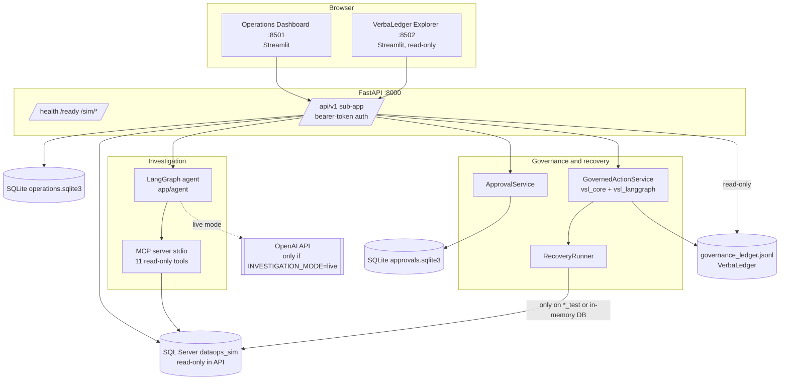

| Layer | Technology |
|---|---|
| Language | Python 3.10+ (CI matrix targets 3.10 and 3.12) |
| API | FastAPI, Uvicorn, Pydantic v2 |
| Data | SQL Server via SQLAlchemy and `pyodbc` (simulation); SQLite (workflow and approval stores); JSON Lines (ledger) |
| Agent | LangGraph state machine; MCP (`mcp` package) over stdio; optional OpenAI client |
| Governance | `vsl_core`, `vsl_langgraph`, VerbaLedger |
| UI | Streamlit, Plotly, pandas |
| Tests | pytest, Streamlit `AppTest`, an in-memory simulator fake |

Pinned versions are in [requirements.txt](requirements.txt) and [requirements-dashboard.txt](requirements-dashboard.txt).
Further design notes: [docs/architecture.md](docs/architecture.md).

**Four stores, on purpose**

| Store | Holds | Written by |
|---|---|---|
| SQL Server `dataops_sim` | Simulated pipelines, runs, validation results, simulator incidents | Setup scripts and the pipeline simulator; recovery only on `*_test` databases |
| `data/operations.sqlite3` | Workflow incidents, investigations, recoveries, ticket records | The API |
| `data/approvals.sqlite3` | Approval requests and decisions | The approval service |
| `data/governance_ledger.jsonl` | Governance events | The governance layer; the Explorer is read-only |

---

## Repository structure

```text
app/
  main.py               FastAPI root app; mounts /api/v1
  config.py             Settings (environment variables)
  api/v1/               routes/ (incidents, simulator, reviews, approvals, recoveries, ledger, demo, dashboard, tickets, health), permissions.py, security.py
  agent/                LangGraph investigation: graph, llm, prompts, report, offline, mcp_client, runner, config
  mcp_server/           Read-only MCP server (stdio) and tool provider
  diagnostics/          Read-only diagnostic queries (readonly.py)
  governance/           policy, gates, workflow, actions, ledger, ledger_view, audit_cli
  recovery/             actions, runner, workflow, approvals, auth, reenable
  services/             investigations, recoveries, status, container (service wiring)
  persistence/          SQLite schema and repositories
  simulation/           SQL Server simulator, scenarios, generator, demo_incidents.py
  demo/                 In-process synthetic demo incidents (DEMO-nnnn)
  integrations/         github_issues.py (optional ticketing)
  core/                 startup validation
dashboard/              ops_app.py (Operations Dashboard), ledger_app.py (VerbaLedger Explorer), clients and view models
scripts/                db_init, db_seed, db_seed_demo_incidents, db_verify, scenario, investigate, dev_stack, check_prereqs, ...
tests/                  pytest suite; tests/integration/ needs a real SQL Server
docs/                   design notes and docs/screenshots/
data/                   Runtime SQLite stores and the ledger (local state)
Dockerfile, docker-compose.yml, .github/workflows/ci.yml   Deployment/CI foundations (not run by the author)
```

---

## API reference

Interactive documentation: <http://127.0.0.1:8000/docs> (merged OpenAPI for the root app and `/api/v1`). The table below was
generated from the application's OpenAPI document (45 operations). "Auth" is the permission the route needs; all `/api/v1`
routes except health/ready require a bearer token. The `/sim/*` routes on the root app are **unauthenticated** (development).

| Category | Method and path | Auth / notes |
|---|---|---|
| Health | `GET /health`, `GET /ready`, `GET /api/v1/health`, `GET /api/v1/ready` | Open. `ready` reports configuration state such as the authentication mode and investigation mode |
| Simulator (read) | `GET /sim/db-status`, `/sim/pipelines`, `/sim/runs`, `/sim/runs/{run_id}`, `/sim/scenarios` | Unauthenticated, read-only |
| Simulator (authenticated) | `GET /api/v1/simulator/pipelines`, `/runs`, `/incidents`, `/incidents/{incident_id}` | read |
| Simulator import | `POST /api/v1/simulator/incidents/{incident_id}/import` | `incident:create`; idempotent |
| Incidents | `POST /api/v1/incidents`, `GET /api/v1/incidents`, `GET /api/v1/incidents/{incident_id}`, `GET /api/v1/incidents/{incident_id}/status` | create needs `incident:create`; others read |
| Investigations | `POST /api/v1/incidents/{incident_id}/investigations` (202), `GET .../investigations`, `GET /api/v1/investigations/{investigation_id}`, `GET /api/v1/incidents/{incident_id}/report` | start needs `investigation:run` |
| Reviews | `GET /api/v1/reviews`, `/reviews/summary`, `/reviews/{review_id}` | read; 503 `recovery_unavailable` when recovery is off |
| Approvals | `GET /api/v1/approvals/{request_id}`, `POST /api/v1/approvals/{request_id}/decision` | decision needs `approval:decide` plus the per-action approver permission |
| Recovery | `POST /api/v1/incidents/{incident_id}/recoveries`, `GET .../recoveries`, `GET /api/v1/recoveries`, `GET /api/v1/recoveries/{recovery_id}`, `POST /api/v1/recoveries/{recovery_id}/resume` | request/resume need `recovery:request` / `recovery:resume` |
| Tickets | `POST /api/v1/incidents/{incident_id}/ticket`, `GET .../ticket`, `POST .../ticket/sync` | `ticket:manage`; GitHub Issues only, optional |
| Ledger | `GET /api/v1/ledger/summary`, `/events`, `/events/{entry_id}`, `/trace`, `/integrity`, `/audit` | `ledger:read`, read-only |
| Demo | `GET /api/v1/demo/summary`, `/demo/incidents`, `/demo/incidents/{incident_id}` | Synthetic data only |
| Dashboard | `GET /api/v1/dashboard/summary` | read |

**Roles** (`app/api/v1/permissions.py`): `viewer`/`api_reader` (read + ledger), `investigator` (read + create + investigate),
`operator` (adds recovery request/resume and tickets), `recovery_approver`/`recovery_admin` (read + decide + ledger),
`governance_authority` (no HTTP permissions).

**Verification level.** The table lists documented routes taken from the generated OpenAPI. Route behaviour is exercised by
the automated tests (for example `tests/test_api_v1.py`, `test_api_e2e.py`, `test_phase11_reviews_demo.py`,
`test_phase10_ledger_api.py`) against in-memory fakes; the author did not individually exercise every route manually, and the
SQL Server paths were not run in the documentation environment.

---

## Installation and setup

**Prerequisites:** Windows 10/11 with PowerShell, Git, 64-bit Python 3.10 or newer. For the simulator: a local SQL Server
(Express is fine) and Microsoft ODBC Driver 17 or 18 for SQL Server ([docs/windows-setup.md](docs/windows-setup.md)). No OpenAI
key is needed for anything below. Commands were written for Windows PowerShell; they were not executed on Windows by the author.

```powershell
cd "<path-to-your-clone>\AI DataOps Agent"
python -m venv .venv
.\.venv\Scripts\Activate.ps1
python -m pip install -r requirements.txt
python -m pip install -r requirements-dashboard.txt
Copy-Item .env.example .env        # first time only
```

If PowerShell blocks activation: `Set-ExecutionPolicy -Scope Process RemoteSigned` (this window only). Note that
`requirements.txt` installs the VSL adapter from a pinned GitHub commit, so `git` and network access to GitHub are needed.

Edit `.env` yourself (`notepad .env`). It is git-ignored; never commit it or paste it into chats. Minimum for Windows
authentication to a named instance:

```text
DB_SERVER=localhost\SQLEXPRESS03
DB_NAME=dataops_sim
DB_AUTH_MODE=windows
DB_TRUST_SERVER_CERTIFICATE=true     # local development only
```

| Variable | Default | Notes |
|---|---|---|
| `DB_SERVER` / `DB_NAME` | `localhost` / `dataops_sim` | `DB_NAME` must end in `_sim` or `_test` for init/reset |
| `DB_AUTH_MODE` | `windows` | or `sql` with `DB_USER` / `DB_PASSWORD` (secrets; local `.env` only) |
| `DB_DRIVER` | `ODBC Driver 18 for SQL Server` | must match an installed driver |
| `INVESTIGATION_MODE` | `offline` | `live` calls OpenAI and needs `OPENAI_API_KEY` (billable, unvalidated) |
| `OPENAI_API_KEY`, `OPENAI_MODEL` | none | placeholders in `.env.example`; not needed for the demo |
| `GITHUB_TOKEN`, `GITHUB_OWNER`, `GITHUB_REPO` | none | optional ticketing; never needed for the demo |
| `APP_ENV` | development | `production` enables strict start-up validation (see [Security](#security-and-safeguards)) |

### Prepare the simulator database (one time)

```powershell
python -m scripts.check_prereqs          # read-only diagnosis of driver, connection and auth
python -m scripts.db_init                # creates the database and tables; never deletes anything
python -m scripts.db_seed                # deterministic baseline (INC-0001, INC-0002, runs, ...); idempotent
python -m scripts.db_verify              # checks tables, relationships and baseline counts
```

### Add the synthetic simulator incidents (optional, safe to repeat)

```powershell
python -m scripts.db_seed_demo_incidents --dry-run     # shows what would be inserted; changes nothing
python -m scripts.db_seed_demo_incidents               # inserts the missing ones
```

It only issues `INSERT`s, never drops, truncates, resets or updates, and running it again inserts 0. Nothing seeds
automatically at startup.

### Enable Human Review and recovery

Recovery can write to the simulation, so the service refuses to initialise unless the database name ends in `_test`. With
`DB_NAME=dataops_sim`, Human Review and recovery are therefore reported as unavailable (HTTP 503 `recovery_unavailable`).
This is a deliberate safety rule, not a bug, and nothing was loosened to hide it. To run the full approval and recovery demo,
use a **separate** database. This changes the name for the current PowerShell window only and does not touch `.env` or `dataops_sim`:

```powershell
$env:DB_NAME = "dataops_demo_test"        # any name ending in _test; avoid dataops_sim_test (used by SQL Server integration tests)
python -m scripts.db_init
python -m scripts.db_seed
python -m scripts.db_seed_demo_incidents
python -m scripts.db_verify
python -m scripts.scenario activate duplicate-records   # injects a real simulated fault so a recovery can be proposed
```

Check that each command prints `database=dataops_demo_test`, then start the stack **from the same window**. If your SQL Server
uses a restricted SQL login, create it for the new database too (`python -m scripts.db_create_app_login`). Undo the injected
fault later with `python -m scripts.scenario restore-all`. Running this on a real `*_test` SQL Server database is untested by the author.

---

## Running the application

```powershell
.\.venv\Scripts\python.exe -m scripts.dev_stack --show-approver-token --open
```

Wait for `VERIFIED. Open:`. The launcher reports success only after it checks that authentication is on, a viewer token works,
no token gets `401`, and both dashboards answer. Flags: `--api-port`, `--ops-port`, `--ledger-port`, `--no-ui`, `--check-only`.

| What | URL |
|---|---|
| API interactive docs (Swagger) | <http://127.0.0.1:8000/docs> |
| Operations Dashboard | <http://127.0.0.1:8501> |
| VerbaLedger Explorer (read-only) | <http://127.0.0.1:8502> |

* Tokens are random, written on first run to `.dev\dev_auth.json` (git-ignored). `--show-approver-token` prints the approver
  token once; you type it into the Human Review form. Never put tokens in screenshots or chats.
* Stop with `Ctrl+C` in the launcher window; it stops only processes it started.
* The launcher refuses to run with `APP_ENV=production`.

**Quick walkthrough (about 10 minutes).** (1) Dashboard, **Incidents**, *SQL Server simulator*: browse, filter, open an
incident. (2) **Import into workflow store**. (3) **Investigate**, then read findings, evidence and the unconfirmed hypothesis.
(4) With the `_test` database and an injected scenario, investigate its incident and press **Request recovery proposal**.
(5) **Human Review**: check evidence, action and risk; approve or reject with a reason and the approver token.
(6) Read the recovery outcome. (7) Open the VerbaLedger Explorer and check events and **Integrity**.
Synthetic demo incidents get log-based findings but, by design, no recovery proposal.

---

## Screenshots

> **Provenance.** These are real screenshots of the real dashboards, captured with Playwright/Chromium in a Linux test sandbox
> that used the **in-memory simulator** (no SQL Server) and a fixed test clock. They were not captured on Windows or against
> SQL Server, and show simulated data.

| | |
|---|---|
| 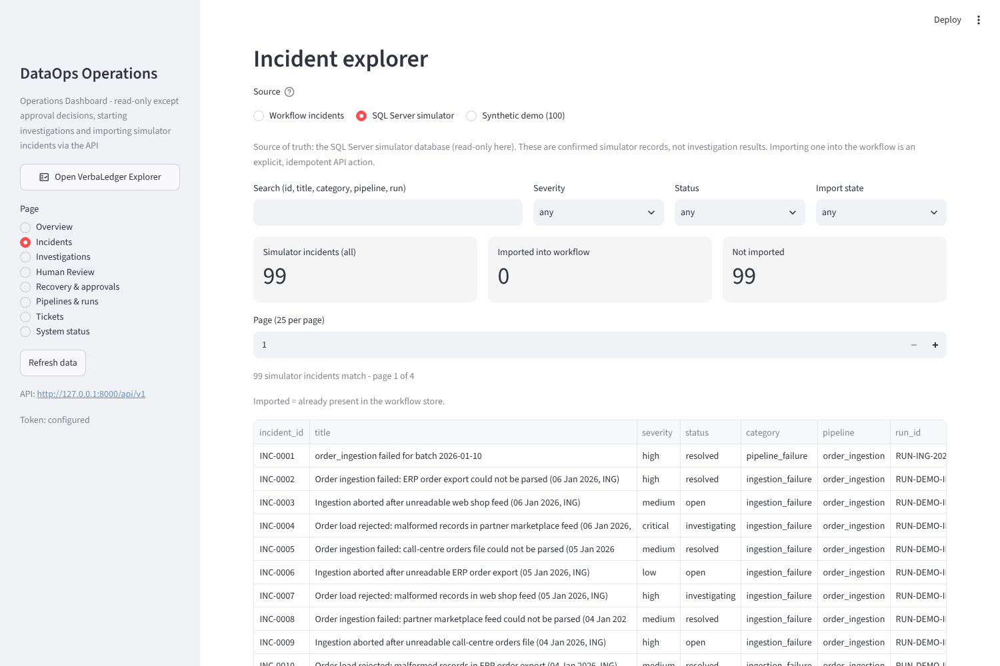<br>1. Incident Explorer | 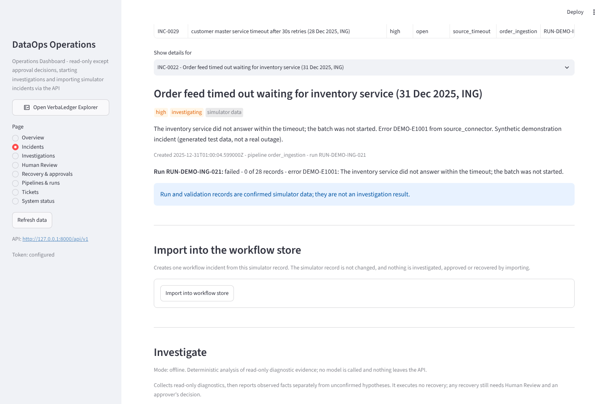<br>2. Filter and select |
| 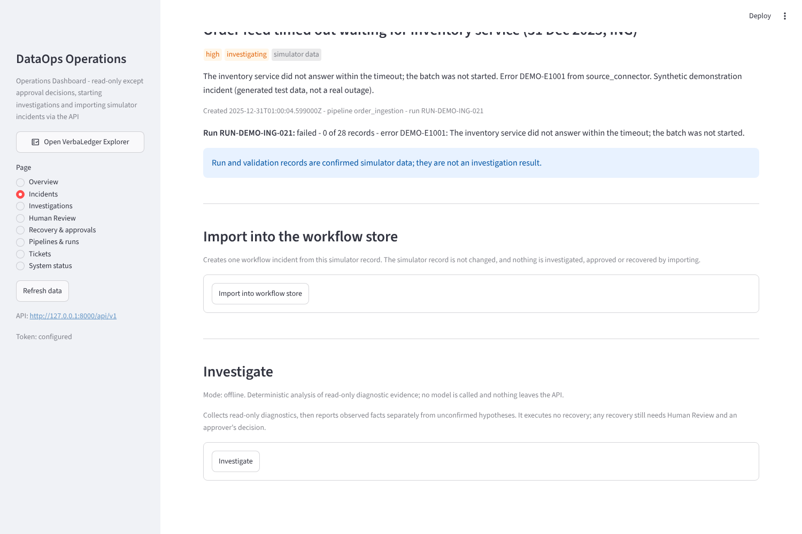<br>3. Details and import | 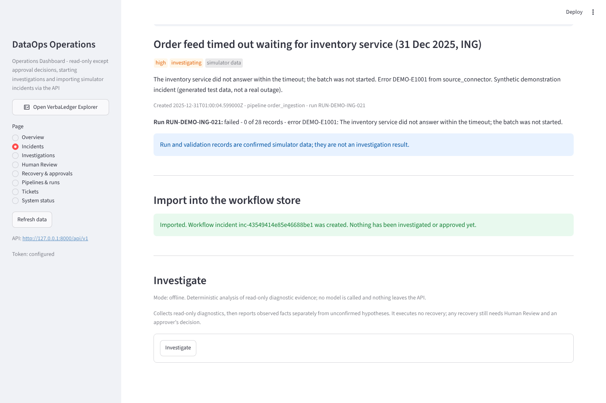<br>4. Import success |
| 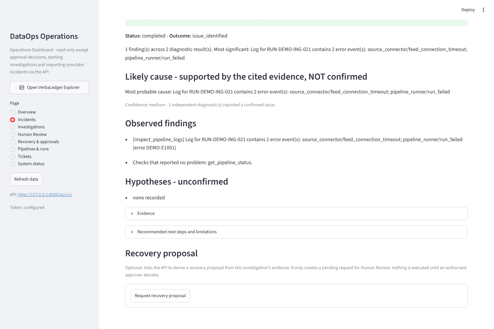<br>5. Investigation result | 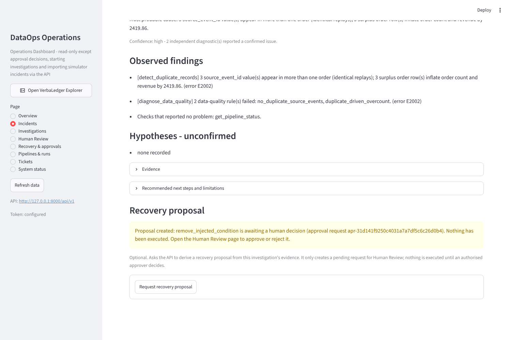<br>6. Recovery proposal |
| 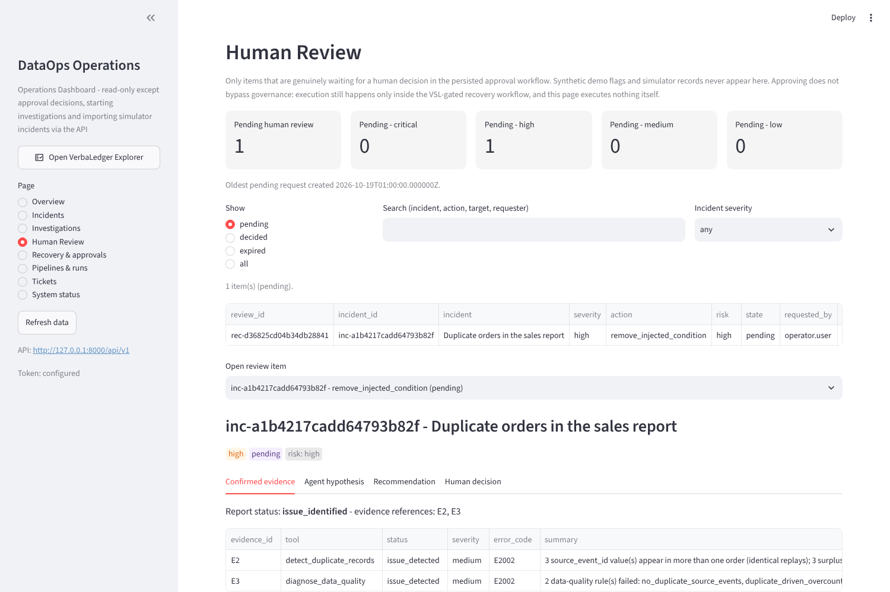<br>7. Human Review queue | 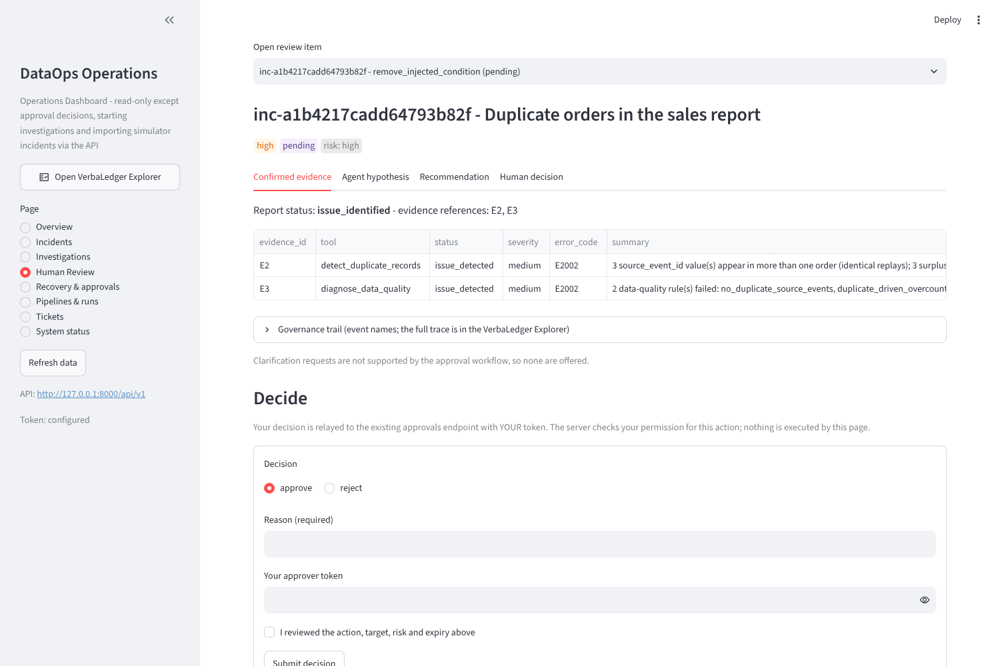<br>8. Review detail |
| 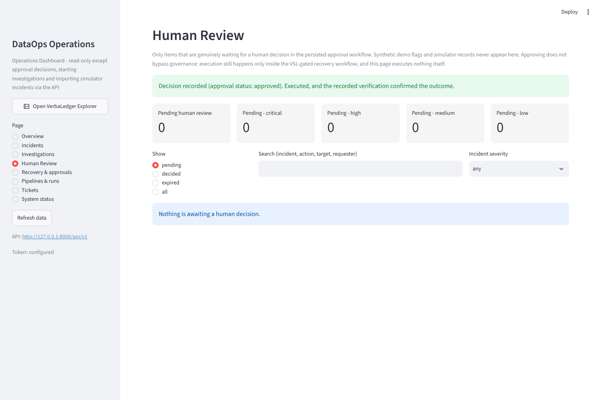<br>9. Decision recorded | 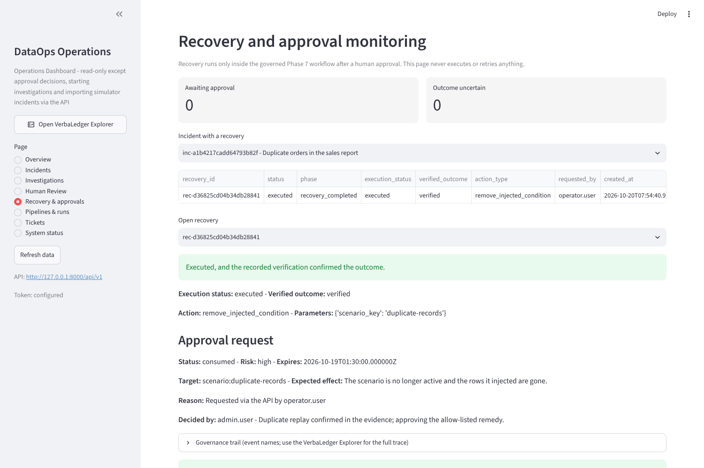<br>10. Recovery outcome |
| 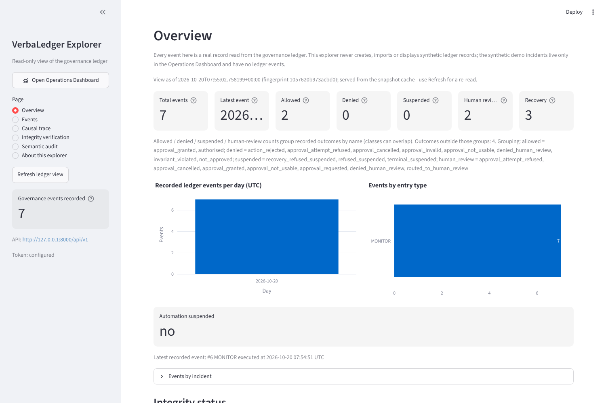<br>11. VerbaLedger overview | 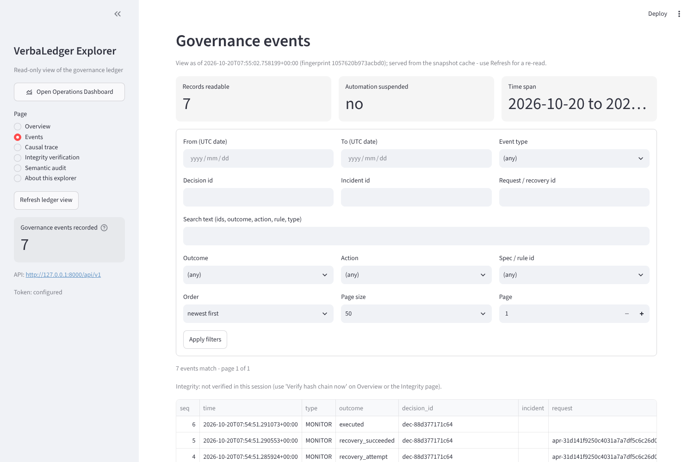<br>12. Events |
| 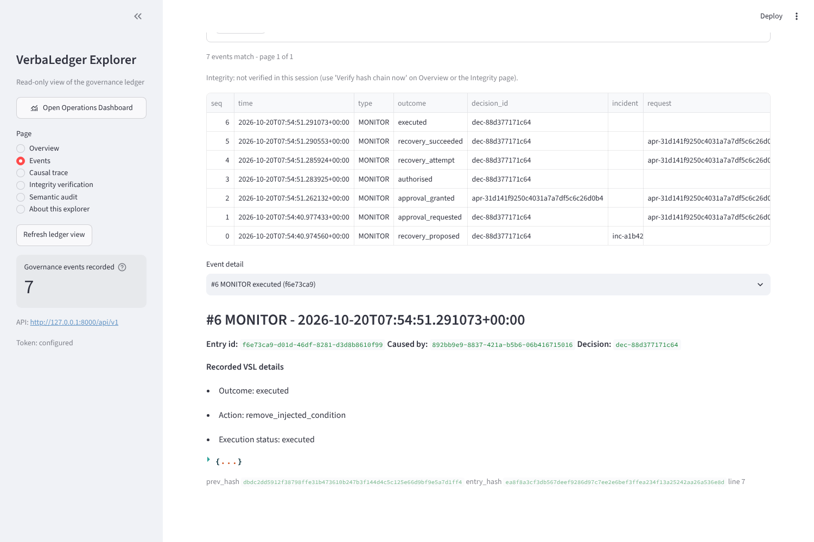<br>13. Event detail | 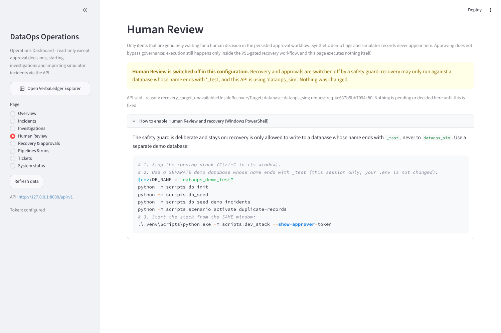<br>14. Human Review when recovery is off (`dataops_sim`) |

---

## Testing and validation

```powershell
python -m pytest -q                                   # full suite; no database, no OpenAI key
$env:RUN_SQLSERVER_TESTS='1'; $env:DB_SERVER='.\SQLEXPRESS03'
python -m pytest -m integration -v                    # needs local SQL Server; uses dataops_sim_test only
```

| Result | Status |
|---|---|
| 1,267 passed, 44 skipped on Python 3.10 and Python 3.12 (development VM) | **Previously reported** by the project owner; not re-run for this README |
| 1,319 passed, 44 skipped on Python 3.10, current checkout (1,363 tests collected) | Run in a Linux sandbox while preparing this README; the test count has grown since the earlier report |
| 44 SQL Server integration tests | **Skipped** without `RUN_SQLSERVER_TESTS=1`. A skip is not a pass |

What the tests do cover: API routes and permissions, persistence, the agent graph with a fake model and fake MCP server, MCP
tool read-only behaviour, VSL gates and workflow, approvals (binding, single use, expiry), recovery actions, ledger and audit
views, dashboard pages (Streamlit `AppTest`), start-up validation and the launcher. CI (`.github/workflows/ci.yml`) is configured to
run them on Python 3.10 and 3.12 plus the VSL conformance suite; it has not been observed running by the author.

What they do **not** prove: behaviour on a real SQL Server or Windows, live OpenAI output quality, browser behaviour outside the
sandbox, real GitHub ticketing, container builds, multi-user concurrency, or the correctness of an investigation's conclusions
on real incidents. Passing unit tests are not proof of end-to-end function in your environment.

---

## Security and safeguards

| Safeguard | Where | Scope |
|---|---|---|
| Read-only agent tools | MCP server, `ReadOnlyRepo.READ_METHODS` allow-list, `APPROVED_TOOLS` | Application-level; the DB login itself is not necessarily read-only |
| Bearer-token auth with roles | `app/api/v1/security.py`, `permissions.py`, `app/recovery/auth.py` | **Development:** `dev_static` tokens, stored as SHA-256 digests |
| Backend-enforced permissions | route dependencies and `ApprovalService` | Applies to UI and direct API calls alike |
| Exact-action, single-use, expiring approvals with HMAC seal | `app/recovery/approvals.py` | Implemented and unit-tested |
| Recovery limited to 2 actions, strict schemas, `_test`/in-memory DB only | `app/recovery/actions.py` | Simulation only |
| No secrets in the repo | `.env.example` holds placeholders; `.env` and `.dev/` are git-ignored | Check your own clone before sharing |
| Production start-up validation | `app/core/startup.py` | With `APP_ENV=production` the process refuses to start on unsafe settings, such as `dev_static` auth |
| Ledger read API is separate | `ledger:read` permission | Explorer cannot write |

**Development versus production.** This is a development and demonstration system. There is no production identity provider,
no TLS termination, no rate limiting, and no multi-replica support (SQLite and the JSONL ledger are single-host files).
The unauthenticated `/sim/*` routes are for local use. Do not expose the API to a network, and do not point it at real data
or real systems. Nothing here is security-audited or compliance-certified.

---

## Troubleshooting

| Symptom | Cause and fix |
|---|---|
| `[Errno 10048]`, port 8000 in use | Find the process: `Get-NetTCPConnection -LocalPort 8000 -State Listen \| Select OwningProcess`, then `Get-Process -Id <pid>`. Stop it yourself if it is yours, or run the launcher with `--api-port 8010` (and likewise `--ops-port`, `--ledger-port`). |
| `401 Unauthorized` in a dashboard | Started without the launcher's token. Stop and use `scripts.dev_stack`, not separate `streamlit run` windows. |
| `ModuleNotFoundError: dashboard / app / scripts` | Run from the project root with the venv active and use `python -m ...`. |
| Explorer empty, hint to run the seed command | Run `python -m scripts.db_seed_demo_incidents`. |
| Seeder says there is no baseline | Run `python -m scripts.db_seed` first. |
| "Named Pipes Provider" or other DB errors | Wrong `DB_SERVER`, stopped service or wrong driver; see [docs/windows-setup.md](docs/windows-setup.md). |
| Investigate shows "still running" | The dashboard waits up to 10 s; press **Refresh data**. |
| Human Review: "switched off by a safety guard" (503 `recovery_unavailable`) | Expected with `DB_NAME=dataops_sim`. See [Enable Human Review and recovery](#enable-human-review-and-recovery). |
| Human Review is empty / ledger shows 0 events | Correct on a fresh install; they fill only after the real workflow runs. |
| `.env` changes ignored | Restart the process; run from the project root. |

---

## Project status

| Area | Status | Notes |
|---|---|---|
| Incident import (simulator to workflow store) | Implemented, verified by tests (in-memory) | SQL Server path not run by the author |
| Dashboard to investigation link | **Partial** | Works for workflow incidents and imported simulator incidents. The 100 synthetic demo incidents are browse-only |
| Investigation agent, offline mode | Implemented, verified by tests | Heuristic, not an LLM |
| Investigation with live OpenAI | **Implemented, not validated** | No live call made by the author; output quality unknown |
| Evidence handling and root-cause analysis | Implemented; grounding enforced in code | Conclusions are unvalidated on real incidents |
| VSL gates and governed workflow | Implemented, verified by tests | Not independently reviewed; binary gate values, not calibrated confidence |
| Human Review and approvals | Implemented, verified by tests | Requires a `_test` database; not run on SQL Server |
| Recovery execution | Implemented, **simulated only** | 2 actions; not a real production operation |
| VerbaLedger and audit | Implemented; tamper-**evident** within a file | Not tamper-proof; no external anchoring; no compliance claim |
| Ticketing (GitHub Issues) | Implemented, tested with fakes | Not run against real GitHub |
| Authentication | Development only | `dev_static` tokens |
| Real data-mart / warehouse integration | **Not implemented** | Only the simulator |
| Docker / CI | Present, not executed by the author | |

---

## Future development

These are ideas, not commitments:

* Run and document the full flow on Windows with SQL Server; capture screenshots there.
* A real identity provider and UI authentication in place of `dev_static`.
* Validate live OpenAI investigations with an evaluation set.
* Let the synthetic demo incidents flow through investigation, and add recovery proposals for more incident categories.
* Connect to a real read-only data mart; add alerting, an externally anchored ledger checkpoint and a multi-replica store.

---

## Documentation validation notes

This README was written from the source code, and every file path, command name and API route was cross-checked against the
repository. These items could **not** be verified in the documentation environment:

* Windows PowerShell commands and the Windows setup (the sandbox is Linux).
* Any run against a real SQL Server, including the `_test` demo database flow.
* Live OpenAI calls and the model's real behaviour.
* Docker build, `docker-compose` and GitHub Actions execution.
* GitHub ticketing against real GitHub.
* Browser behaviour outside the Linux sandbox.
* The earlier 1,267 passed / 44 skipped result on Python 3.10 and 3.12 (taken from the project owner's earlier report).
